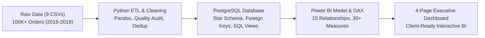
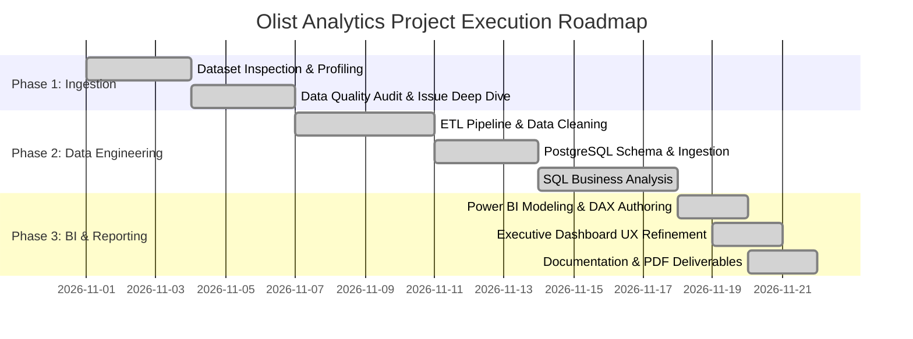

# 🛒 Olist E-Commerce Business Intelligence – Project Overview

## 1. Executive Summary

This project delivers an enterprise-grade, end-to-end Business Intelligence and Data Analytics solution for **Olist**, the largest e-commerce department store marketplace in Brazil. 

Connecting small and medium merchants across Brazil directly to major marketplaces (Mercado Livre, B2W, Amazon, Magazine Luiza), Olist manages thousands of transactions daily. However, operating a decentralized merchant marketplace introduces complex operational challenges: wide variation in shipping durations across Brazil's 27 states, freight cost sensitivities, customer churn, seller performance disparities, and fluctuating customer satisfaction levels.

This repository implements a complete analytics lifecycle that transforms raw, unorganized transactional datasets into structured relational data models and executive-ready decision-support tools.



---

## 2. Business Problem & Objectives

### The Business Challenge
Operating as a marketplace connector means Olist does not own inventory or logistics fleets directly; it coordinates independent sellers and carrier networks. Executive leadership faced three core visibility gaps:
1. **Revenue Drivers vs. Shipping Costs**: How much revenue is driven by high-value product sales versus freight expenses, and which categories carry disproportionate shipping burdens?
2. **Geographic Concentration**: Where are high-value customers located relative to the merchant base, and what does regional disparity mean for delivery SLAs?
3. **Logistics & Customer Satisfaction**: What is the quantifiable relationship between delivery lead times, carrier delays, and customer review scores?

### Core Analytical Objectives
- **Macro Performance**: Monitor gross revenue (R$ 15.84M), order volumes (99,441), unique customer acquisition (96,096), and average order value (R$ 160.58).
- **Product Portfolio Performance**: Identify top categories and products using Pareto distribution principles (80/20 rule).
- **Merchant Dynamics**: Track seller distribution, revenue concentration, and geographic clusters.
- **Logistics & SLAs**: Evaluate carrier delivery performance, on-time delivery rates (91.89%), and shipping durations.
- **Customer Satisfaction**: Analyze review distributions (4.09 / 5.00 average) and isolate the root causes of negative reviews (1-2 stars).

---

## 3. Technology Stack & Architecture

| Layer | Technology | Primary Function |
|---|---|---|
| **Data Ingestion & Cleaning** | Python 3.10, Pandas, NumPy | Dataset auditing, null handling, deduplication, timestamp normalization, and data validation |
| **Relational Database** | PostgreSQL 15+ | Relational schema management, primary/foreign key constraints, and SQL analytical views |
| **Database Connector** | SQLAlchemy, Psycopg2 | Automated data pipeline ingestion from cleaned CSVs into PostgreSQL |
| **Business Analysis** | SQL (PostgreSQL Dialect) | Aggregations, window functions, customer cohort analysis, and data validation queries |
| **Business Intelligence** | Microsoft Power BI Desktop | Star-schema modeling, DAX measure authoring, visual design, and interactive filtering |
| **Theme & UI Styling** | PBIR (Fabric JSON), CSS Colors | Corporate Dark Navy (`#071A33`), Electric Blue (`#168BEB`), and Cyan (`#38BDF8`) design system |
| **Documentation & Reports** | Markdown, ReportLab (PDF), PIL | Technical manuals, data dictionaries, automated PDF reports, and visual exports |

---

## 4. Repository Structure

```text
Ecommerce-Business-Intelligence/
│
├── dashboard/                              # Power BI solution files
│   ├── Dashboard.pbix                      # 4-page interactive Power BI dashboard
│   ├── DAX_Measures_Reference.dax          # 30+ production DAX formulas
│   ├── Olist_Dashboard_Theme.json          # Corporate dark theme specification
│   ├── Olist_Ecommerce_Interactive_Dashboard.html # Web-based interactive preview
│   └── PowerBI_Setup_and_Design_Guide.md   # Dashboard setup documentation
│
├── data/                                   # Data storage
│   ├── raw/                                # 9 original Olist CSV files (2016–2018)
│   └── processed/                          # Cleaned, standardized datasets
│
├── database/                               # Database DDL & SQL queries
│   ├── SQL.sql                             # DDL table creation scripts & constraints
│   ├── analysis_queries.sql                # Analytical SQL business queries
│   └── relationship_validation.sql         # Referential integrity test queries
│
├── docs/                                   # Comprehensive project documentation
│   ├── 01_Project_Overview.md              # Project architecture and overview
│   ├── 02_Data_Dictionary.md               # Complete schema and entity data dictionary
│   ├── 03_Data_Cleaning_Methodology.md     # Data audit and cleaning documentation
│   ├── 04_Business_Insights.md             # In-depth executive findings & recommendations
│   └── 05_Dashboard_Guide.md               # User manual for Power BI reporting
│
├── notebooks/                              # Jupyter exploratory notebooks
│   ├── 01_Exploratory_Data_Analysis.ipynb  # EDA, data shapes, null heatmaps, distributions
│   ├── 02_Sales_Analysis.ipynb             # Revenue trajectories, seasonality, categories
│   └── 03_Customer_Analysis.ipynb          # Geography, retention, and satisfaction analysis
│
├── reports/                                # Final deliverables & executive exports
│   ├── Data_Quality_Report.pdf             # Comprehensive audit & validation PDF
│   ├── Business_Analysis_Report.pdf        # C-suite executive analytical report PDF
│   ├── Dashboard_Executive_Overview.png    # High-resolution export of Page 1
│   ├── Dashboard_Sales_Analysis.png        # High-resolution export of Page 2
│   ├── Dashboard_Seller_Customer.png       # High-resolution export of Page 3
│   └── Dashboard_Delivery_Ratings.png      # High-resolution export of Page 4
│
├── src/                                    # Python ETL & automated pipeline scripts
│   ├── 01_inspect_datasets.py              # Initial dataset exploration script
│   ├── 02_data_quality_report.py           # Automated data quality audit generator
│   ├── 03_investigate_data_issues.py       # Deep-dive on anomalies (keys, duplicates)
│   ├── 04_clean_datasets.py                # Production cleaning & transformation pipeline
│   ├── 06_test_database_connection.py     # PostgreSQL connection health check
│   └── 07_load_postgresql.py               # Batch loader from cleaned CSV to PostgreSQL
│
├── .env.example                            # Database environment credentials template
├── .gitignore                              # Git exclusion rules
└── README.md                               # Primary portfolio landing page
```

---

## 5. Key Business Metrics Summary

| Metric | Business Value | Interpretation |
|---|---|---|
| **Total Gross Revenue** | **R$ 15,843,553.24** | Total marketplace volume (Product Sales: R$ 13.59M + Freight: R$ 2.25M) |
| **Total Orders** | **99,441** | Total distinct customer orders placed between Sept 2016 and Oct 2018 |
| **Delivered Orders** | **96,478 (97.02%)** | Successfully completed deliveries fulfilling customer purchases |
| **Unique Customers** | **96,096** | Distinct human buyers identified via `customer_unique_id` |
| **Total Items Sold** | **112,650** | Total line-item units ordered across all marketplace baskets |
| **Average Order Value (AOV)**| **R$ 160.58** | Average gross revenue generated per customer transaction |
| **Average Delivery Duration** | **12.56 Days** | Mean calendar days elapsed from order purchase to customer receipt |
| **On-Time Delivery Rate** | **91.89%** | Percentage of delivered orders arriving on or before estimated promise date |
| **Average Review Rating** | **4.09 / 5.00** | Customer sentiment benchmark across 99,224 verified customer reviews |
| **Customer Retention Rate** | **3.12%** | Proportion of customers who placed more than one order during the period |

---

## 6. Project Roadmap & Key Phases



---

## 7. Deliverables & Outputs

1. **Enterprise Power BI Solution**: Fully functioning, client-ready `.pbix` featuring 4 synchronized executive pages with custom themes, zero-overflow headers, dropdown slicers, and monthly trend curves.
2. **PostgreSQL Relational Database**: Automated DDL scripts establishing 9 normalized tables with enforced referential integrity and validated primary keys.
3. **Data Quality & Business PDF Reports**: Multi-page, executive-level PDF documents created using Python ReportLab detailing data audit findings and strategic business recommendations.
4. **Jupyter Exploratory Notebooks**: Documented `.ipynb` files containing reproducible Python exploratory data analysis, statistical modeling, and data visualizations.
