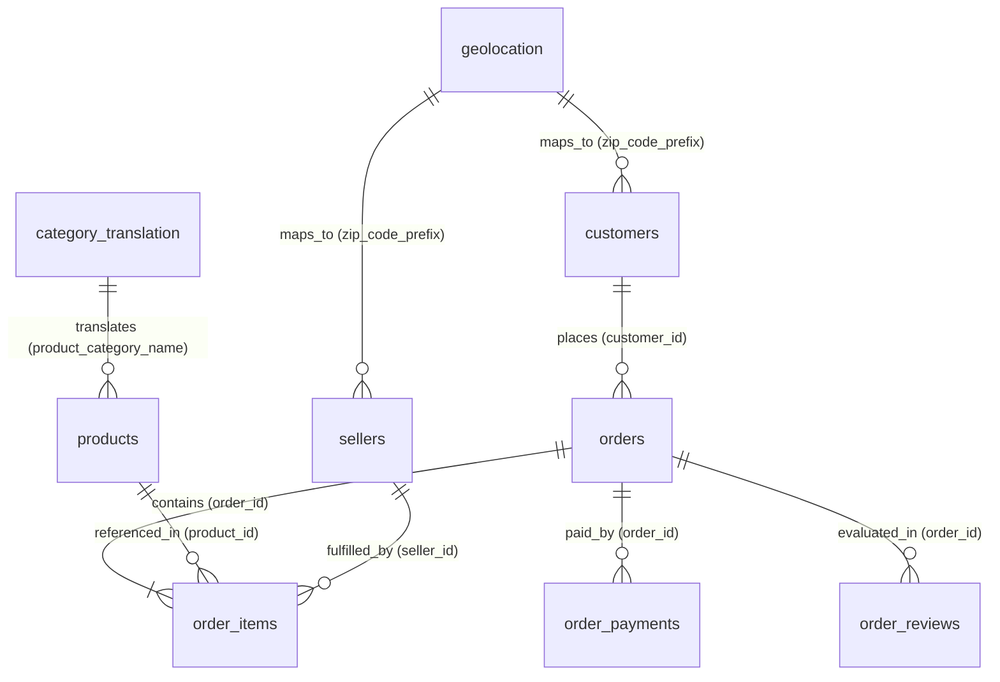

# 📖 Olist E-Commerce – Data Dictionary & Schema Specification

## 1. Relational Schema Architecture

The Olist database follows a **Star/Snowflake hybrid schema** centered on the `orders` and `order_items` transactional fact tables, supported by dimensional tables for customers, products, sellers, reviews, payments, and geolocation.

---

## 2. Table Specifications

### 2.1 `customers`
Contains identity and geographic metadata for buyers.
* **Row Count:** 99,441 records
* **Primary Key:** `customer_id`

| Column Name | Data Type | Nullable | Description & Business Rules |
|---|---|---|---|
| `customer_id` | `VARCHAR(50)` | No | **Primary Key**. Unique identifier assigned to each individual order transaction. Used to link to `orders.customer_id`. |
| `customer_unique_id` | `VARCHAR(50)` | No | Real-world unique customer identifier. Used to track repeat buyers across multiple order transactions. |
| `customer_zip_code_prefix` | `VARCHAR(5)` | No | 5-digit postal code prefix of customer's registered delivery address. |
| `customer_city` | `VARCHAR(100)` | No | Name of the city where customer resides. Standardized to lowercase. |
| `customer_state` | `VARCHAR(5)` | No | Two-letter Brazilian state abbreviation (e.g., SP, RJ, MG, RS, PR). |

> [!NOTE]
> `customer_id` is a transient token generated per order. To compute true unique customer metrics or retention rates, queries **must** aggregate over `customer_unique_id` (96,096 distinct individuals).

---

### 2.2 `orders`
The central transaction table recording purchase timestamps, statuses, and delivery dates.
* **Row Count:** 99,441 records
* **Primary Key:** `order_id`
* **Foreign Key:** `customer_id` $\rightarrow$ `customers(customer_id)`

| Column Name | Data Type | Nullable | Description & Business Rules |
|---|---|---|---|
| `order_id` | `VARCHAR(50)` | No | **Primary Key**. Unique alphanumeric identifier for each order. |
| `customer_id` | `VARCHAR(50)` | No | **Foreign Key** referencing `customers(customer_id)`. |
| `order_status` | `VARCHAR(30)` | No | Order lifecycle status: `delivered`, `shipped`, `canceled`, `invoiced`, `processing`, `unavailable`, `approved`, `created`. |
| `order_purchase_timestamp` | `TIMESTAMP` | No | Exact datetime when customer completed checkout. |
| `order_approved_at` | `TIMESTAMP` | Yes | Datetime when payment was approved by processor (null for canceled/unapproved orders). |
| `order_delivered_carrier_date` | `TIMESTAMP` | Yes | Datetime when merchant handed parcel to the carrier logistics partner. |
| `order_delivered_customer_date` | `TIMESTAMP` | Yes | Datetime when parcel was confirmed received by the customer. |
| `order_estimated_delivery_date` | `TIMESTAMP` | No | Target delivery date communicated to customer at checkout. |

---

### 2.3 `order_items`
Fact table recording each line-item contained in an order, pricing, freight, and seller assignments.
* **Row Count:** 112,650 records
* **Composite Key:** (`order_id`, `order_item_id`)
* **Foreign Keys:** `order_id` $\rightarrow$ `orders(order_id)`, `product_id` $\rightarrow$ `products(product_id)`, `seller_id` $\rightarrow$ `sellers(seller_id)`

| Column Name | Data Type | Nullable | Description & Business Rules |
|---|---|---|---|
| `order_id` | `VARCHAR(50)` | No | **Foreign Key** referencing `orders(order_id)`. |
| `order_item_id` | `INTEGER` | No | Sequential sequential number identifying items within the same order (1, 2, 3...). |
| `product_id` | `VARCHAR(50)` | No | **Foreign Key** referencing `products(product_id)`. |
| `seller_id` | `VARCHAR(50)` | No | **Foreign Key** referencing `sellers(seller_id)`. |
| `shipping_limit_date` | `TIMESTAMP` | No | Seller fulfillment deadline to ship order to logistics carrier. |
| `price` | `NUMERIC(10,2)` | No | Base selling price of the individual item in Brazilian Reais (R$). |
| `freight_value` | `NUMERIC(10,2)` | No | Shipping fee charged for the item in Brazilian Reais (R$). |

---

### 2.4 `order_payments`
Records customer payment methods, sequential installment plans, and transaction values.
* **Row Count:** 103,886 records
* **Composite Key:** (`order_id`, `payment_sequential`)
* **Foreign Key:** `order_id` $\rightarrow$ `orders(order_id)`

| Column Name | Data Type | Nullable | Description & Business Rules |
|---|---|---|---|
| `order_id` | `VARCHAR(50)` | No | **Foreign Key** referencing `orders(order_id)`. |
| `payment_sequential` | `INTEGER` | No | Sequential index when customer splits payment across multiple cards/vouchers (1, 2, 3...). |
| `payment_type` | `VARCHAR(30)` | No | Method of payment: `credit_card`, `boleto` (bank slip), `voucher`, `debit_card`, `not_defined`. |
| `payment_installments` | `INTEGER` | No | Number of installment payments selected by customer (1 to 24). |
| `payment_value` | `NUMERIC(10,2)` | No | Total amount charged in this transaction payment slice (R$). |

---

### 2.5 `order_reviews`
Customer post-purchase ratings and text feedback.
* **Row Count:** 99,224 records
* **Primary Key:** `review_id`
* **Foreign Key:** `order_id` $\rightarrow$ `orders(order_id)`

| Column Name | Data Type | Nullable | Description & Business Rules |
|---|---|---|---|
| `review_id` | `VARCHAR(50)` | No | Unique identifier for customer review submission. |
| `order_id` | `VARCHAR(50)` | No | **Foreign Key** referencing `orders(order_id)`. |
| `review_score` | `INTEGER` | No | Customer rating on integer scale from 1 (worst) to 5 (best). |
| `review_comment_title` | `VARCHAR(255)` | Yes | Short title or summary provided by reviewer. (~88% null). |
| `review_comment_message` | `TEXT` | Yes | Detailed written feedback provided by reviewer. (~58% null). |
| `review_creation_date` | `TIMESTAMP` | No | Datetime when review survey invitation was sent to customer. |
| `review_answer_timestamp` | `TIMESTAMP` | No | Datetime when customer completed and submitted the review. |

---

### 2.6 `products`
Catalog dimensional attributes and physical packaging metrics for sold products.
* **Row Count:** 32,951 records
* **Primary Key:** `product_id`
* **Foreign Key:** `product_category_name` $\rightarrow$ `category_translation(product_category_name)`

| Column Name | Data Type | Nullable | Description & Business Rules |
|---|---|---|---|
| `product_id` | `VARCHAR(50)` | No | **Primary Key**. Unique alphanumeric identifier for each product SKU. |
| `product_category_name` | `VARCHAR(150)` | Yes | Portuguese category name (e.g., `beleza_saude`, `cama_mesa_banho`). |
| `product_name_lenght` | `INTEGER` | Yes | Character length of product title. |
| `product_description_lenght` | `INTEGER` | Yes | Character length of product description text. |
| `product_photos_qty` | `INTEGER` | Yes | Number of product photos published on marketplace listing. |
| `product_weight_g` | `INTEGER` | Yes | Physical shipping weight of product in grams. |
| `product_length_cm` | `INTEGER` | Yes | Length of product shipping box in centimeters. |
| `product_height_cm` | `INTEGER` | Yes | Height of product shipping box in centimeters. |
| `product_width_cm` | `INTEGER` | Yes | Width of product shipping box in centimeters. |

---

### 2.7 `sellers`
Merchant directory storing location and operational identity.
* **Row Count:** 3,095 records
* **Primary Key:** `seller_id`

| Column Name | Data Type | Nullable | Description & Business Rules |
|---|---|---|---|
| `seller_id` | `VARCHAR(50)` | No | **Primary Key**. Unique identifier assigned to registered merchant. |
| `seller_zip_code_prefix` | `VARCHAR(5)` | No | 5-digit postal code prefix of merchant's warehouse/operating address. |
| `seller_city` | `VARCHAR(100)` | No | City where merchant is headquartered. |
| `seller_state` | `VARCHAR(5)` | No | Two-letter state abbreviation of merchant's location. |

---

### 2.8 `category_translation`
Lookup table mapping Portuguese e-commerce categories to English equivalents.
* **Row Count:** 71 records
* **Primary Key:** `product_category_name`

| Column Name | Data Type | Nullable | Description & Business Rules |
|---|---|---|---|
| `product_category_name` | `VARCHAR(150)` | No | **Primary Key**. Original Portuguese category designation. |
| `product_category_name_english` | `VARCHAR(150)` | No | Standard English category translation (e.g., `health_beauty`, `bed_bath_table`). |

---

### 2.9 `geolocation`
Spatial reference dataset mapping Brazilian postal codes to geographic coordinates.
* **Row Count:** 19,015 distinct postal prefixes (deduplicated from 1,000,163 raw coordinate pings)
* **Primary Key:** `geolocation_zip_code_prefix`

| Column Name | Data Type | Nullable | Description & Business Rules |
|---|---|---|---|
| `geolocation_zip_code_prefix`| `VARCHAR(5)` | No | **Primary Key** (in cleaned model). 5-digit postal prefix. |
| `geolocation_lat` | `DOUBLE PRECISION`| No | Centroid latitude coordinate calculated across GPS observations. |
| `geolocation_lng` | `DOUBLE PRECISION`| No | Centroid longitude coordinate calculated across GPS observations. |
| `geolocation_city` | `VARCHAR(150)` | No | Primary city name associated with postal prefix. |
| `geolocation_state` | `VARCHAR(5)` | No | State code associated with postal prefix. |
