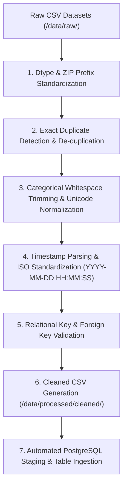

# Data Cleaning Methodology & Pipeline Documentation

## 1. Overview & Data Integrity Objectives

The Olist Brazilian E-Commerce database contains transaction logs from September 2016 through October 2018. While real-world transactional data is inherently noisy, data pipeline reliability requires a systematic, auditable, and repeatable cleaning process. 

The primary objective of this data cleaning methodology is to ensure data integrity, relational consistency, and metric accuracy while adhering strictly to the principle of **conservative data curation**:
1. **Preserve business facts**: Never delete operational records (such as canceled orders or reviews without text) when their missingness reflects legitimate business states.
2. **Eliminate structural redundancy**: Remove pure duplicate telemetry entries (notably in high-frequency geolocation tracking).
3. **Enforce relational schema integrity**: Clean foreign key references, standardize ISO timestamps, trim whitespace, and guarantee primary key uniqueness prior to loading into PostgreSQL.

---

## 2. Source-to-Target Data Quality Scorecard

| Dataset | Original Rows | Cleaned Rows | Duplicates Removed | Missing Values Preserved | Primary / Candidate Key | Key Uniqueness |
| :--- | :---: | :---: | :---: | :---: | :--- | :---: |
| `olist_customers_dataset.csv` | 99,441 | 99,441 | 0 | 0 | `customer_id` | 100% Unique |
| `olist_geolocation_dataset.csv` | 1,000,163 | 738,332 | 261,831 | 0 | `(zip_code_prefix, lat, lng)` | 100% Valid |
| `olist_orders_dataset.csv` | 99,441 | 99,441 | 0 | 4,908 | `order_id` | 100% Unique |
| `olist_order_items_dataset.csv` | 112,650 | 112,650 | 0 | 0 | `(order_id, order_item_id)` | 100% Unique |
| `olist_order_payments_dataset.csv` | 103,886 | 103,886 | 0 | 0 | `(order_id, payment_sequential)` | 100% Unique |
| `olist_order_reviews_dataset.csv` | 99,224 | 99,224 | 0 | 145,903 | `review_id` / `(review_id, order_id)` | Audited (see below) |
| `olist_products_dataset.csv` | 32,951 | 32,951 | 0 | 2,448 | `product_id` | 100% Unique |
| `olist_sellers_dataset.csv` | 3,095 | 3,095 | 0 | 0 | `seller_id` | 100% Unique |
| `product_category_name_translation.csv` | 71 | 71 | 0 | 0 | `product_category_name` | 100% Unique |

---

## 3. Systematic Cleaning Stages



### Stage 1: Data Type Enforcement & ZIP Code Prefix Standardization
- **Problem**: ZIP code prefixes in Brazil (`CEP`) are 5-digit strings (e.g., `01001`). When read as integers by analytical engines, leading zeroes are stripped (turning `01001` into `1001`), destroying geolocation join accuracy.
- **Remediation**: Configured explicit `string` dtypes for:
  - `olist_customers_dataset.csv`: `customer_zip_code_prefix`
  - `olist_sellers_dataset.csv`: `seller_zip_code_prefix`
  - `olist_geolocation_dataset.csv`: `geolocation_zip_code_prefix`
- **Output**: All ZIP codes maintained consistent 5-digit formatting across customer, seller, and geolocation tables.

### Stage 2: Geolocation De-duplication
- **Problem**: The raw geolocation table contained 1,000,163 GPS coordinate records. Because carrier ping systems record repeated coordinate signals for identical zip code centers, 261,831 records were 100% identical duplicates across all 5 attributes (`zip_code_prefix`, `latitude`, `longitude`, `city`, `state`).
- **Remediation**: Executed duplicate deduplication using `df.drop_duplicates(keep='first')`.
- **Impact**: Reduced table size from 58.44 MB to 43.15 MB, cutting row count to 738,332 without discarding any distinct geographical points.

### Stage 3: Categorical Whitespace Trimming & Unicode Normalization
- **Problem**: Trailing/leading spaces in city names, order status codes, and category names cause SQL `GROUP BY` and JOIN operations to split identical entities (e.g., `'delivered'` vs `'delivered '`).
- **Remediation**: Trimmed all string columns across all tables:
  - `customer_city`, `customer_state`
  - `seller_city`, `seller_state`
  - `geolocation_city`, `geolocation_state`
  - `order_status`
  - `payment_type`
  - `product_category_name`
  - `product_category_name_english`

### Stage 4: Timestamp Parsing & Standardization
- **Problem**: Timestamps arrived in varied string formats with microsecond or timezone discrepancies.
- **Remediation**: Parsed using `pd.to_datetime(errors='coerce')` and exported in standard ISO format `YYYY-MM-DD HH:MM:SS`:
  - `order_purchase_timestamp`
  - `order_approved_at`
  - `order_delivered_carrier_date`
  - `order_delivered_customer_date`
  - `order_estimated_delivery_date`
  - `shipping_limit_date`
  - `review_creation_date`
  - `review_answer_timestamp`

### Stage 5: Missing Value Audit & Preservation Logic
Unlike naïve data cleaning pipelines that drop null rows, missing values were thoroughly investigated and verified against business process definitions:

1. **`orders` Missing Timestamps (4,908 total null instances)**:
   - `order_approved_at`: 160 nulls. (Associated with orders canceled before payment clearance or bank boleto payment timeouts).
   - `order_delivered_carrier_date`: 1,783 nulls. (Orders canceled prior to dispatch or currently in processing).
   - `order_delivered_customer_date`: 2,965 nulls. (Represents orders that are canceled, invoiced, processing, or actively in transit).
   - *Action*: **Preserved**. Imputing these timestamps would create fictitious delivery records and bias delivery performance metrics.
2. **`products` Missing Attributes (2,448 null instances)**:
   - 610 products lacked category name, weight, and dimensional measurements.
   - *Action*: **Preserved**. Mapped category name to `NULL` (or `'Uncategorized'` in BI semantic layer) so that sales, quantities, and order items tied to these products remain fully accounted for in financial totals.
3. **`order_reviews` Missing Comment Fields (145,903 null instances)**:
   - `review_comment_title`: 87,656 nulls.
   - `review_comment_message`: 58,247 nulls.
   - *Action*: **Preserved**. Over 88% of customers provide star ratings (`1-5`) without providing narrative text. Dropping these rows would discard over 88,000 valid customer review ratings.

---

## 4. Primary Key & Referential Integrity Validation

A dedicated validation script (`src/03_investigate_data_issues.py` and `database/relationship_validation.sql`) verified relational integrity before populating PostgreSQL tables:

1. **`customers` (`customer_id`)**: 99,441 rows, 99,441 unique IDs. 0 duplicates.
2. **`orders` (`order_id`)**: 99,441 rows, 99,441 unique IDs. 0 duplicates.
3. **`order_items` (`order_id`, `order_item_id`)**: 112,650 rows, 112,650 unique composite pairs. 0 duplicates.
4. **`order_payments` (`order_id`, `payment_sequential`)**: 103,886 rows, 103,886 unique composite pairs. 0 duplicates.
5. **`products` (`product_id`)**: 32,951 rows, 32,951 unique IDs. 0 duplicates.
6. **`sellers` (`seller_id`)**: 3,095 rows, 3,095 unique IDs. 0 duplicates.
7. **`order_reviews`**:
   - Total rows: 99,224.
   - Unique `review_id`: 98,410 (814 shared review IDs where a buyer purchased multiple items from distinct sellers under a combined order and submitted a consolidated review).
   - Foreign key constraint to `orders` verified: All `order_id` values map directly to valid records in `orders`.

---

## 5. Automation & Reproducibility

The entire pipeline is executable via command line:
```bash
# 1. Run exploratory profiling
python src/01_inspect_datasets.py

# 2. Generate baseline data quality summary
python src/02_data_quality_report.py

# 3. Investigate anomalies (reviews, geolocation, missing dates)
python src/03_investigate_data_issues.py

# 4. Execute deterministic cleaning pipeline
python src/04_clean_datasets.py

# 5. Ingest into PostgreSQL database
python src/07_load_postgresql.py
```
Output files are systematically saved to `data/processed/cleaned/` with comprehensive audit summaries in `data/processed/cleaning_summary.csv`.
