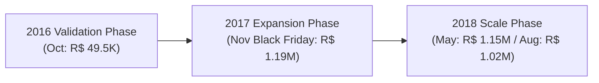
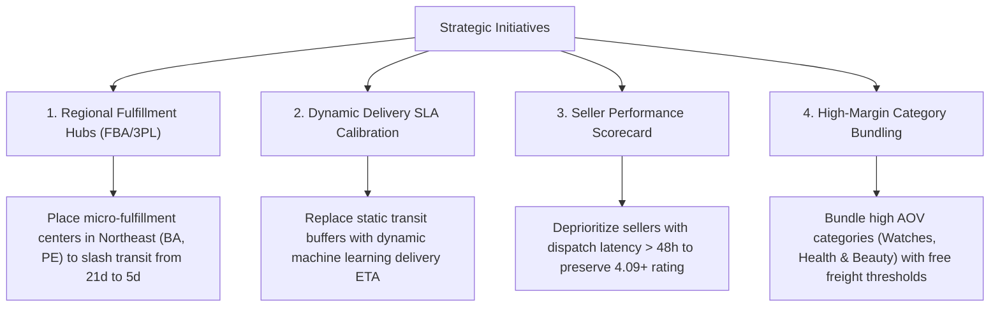

# Olist E-Commerce – Executive Business Insights & Strategic Analysis

## 1. Executive Summary

This report delivers strategic business intelligence derived from the multi-year transactional records of Olist, the largest Brazilian marketplace integrator connecting independent small-to-medium enterprise (SME) merchants to Brazil's leading retail channels.

### High-Level Benchmark KPIs
- **Gross Commercial Volume (Revenue)**: **R$ 15,843,553.24** (R$ 15.84M)
  - *Product Sales*: R$ 13,591,643.70 (85.79%)
  - *Freight Fees*: R$ 2,251,909.54 (14.21%)
- **Total Orders Logged**: **99,441**
  - *Delivered Orders*: **96,478** (**97.02%** completion rate)
  - *Canceled Orders*: 625 (0.63%)
  - *Shipped / In-Transit*: 1,107 (1.11%)
  - *Unavailable / Invoiced / Processing*: 1,231 (1.24%)
- **Items Sold**: **112,650**
- **Catalog Size**: **32,951** unique products across 71 categories
- **Active Merchants (Sellers)**: **3,095**
- **Unique Customers**: **96,096**
- **Average Order Value (AOV)**: **R$ 160.58**
- **Logistics Delivery SLA**: **12.56 days** average transit time (vs. 23.88 days estimated SLA)
- **On-Time Delivery Performance**: **91.89%** of delivered orders arrived on or before estimate
- **Customer Satisfaction**: **4.09 / 5.00** average rating (57.8% 5-star ratings)

---

## 2. Core Strategic Findings & Deep Dives

### Finding 1: Macro Revenue Growth & Seasonal Demand Spikes

1. **Exponential Platform Scale**: Platform sales expanded from R$ 49.5K in late 2016 to averaging over R$ 1.0M monthly in 2018.
2. **Black Friday Catalyst**: November 2017 generated the historical high for single-month order creation, peaking at 7,544 orders and R$ 1.19M in revenue.
3. **Mid-Year Momentum**: May consistently demonstrates a secondary seasonal peak driven by Brazilian Mother's Day (*Dia das Mães*), reaching R$ 1.15M in May 2018.

### Finding 2: Category Concentration (The 80/20 Rule)
A rigorous Pareto analysis reveals that product category sales follow a steep concentration curve:
- **Top 5 Categories Generate 40.5% of Gross Sales**:
  1. `health_beauty` (Beleza & Saúde): **R$ 1.26M** (9,670 orders)
  2. `watches_gifts` (Relógios & Presentes): **R$ 1.21M** (5,624 orders)
  3. `bed_bath_table` (Cama, Mesa & Banho): **R$ 1.04M** (9,417 orders)
  4. `sports_leisure` (Esporte & Lazer): **R$ 0.99M** (7,720 orders)
  5. `computers_accessories` (Informática & Acessórios): **R$ 0.91M** (6,671 orders)
- **Long-Tail Tail Drag**: The bottom 40 categories collectively account for less than 8% of gross commercial revenue.
- **Strategic Recommendation**: Prioritize vendor recruitment and wholesale shipping discounts for the top 10 categories to accelerate platform gross margin.

### Finding 3: Payment Economics & Installment Reliance
Brazilian consumers exhibit a distinct structural preference for financing purchases:
- **Credit Card Dominance**: Accounts for **73.9% of total transaction value** (R$ 12.54M across 76,795 transactions).
  - Average installment count: 3.2 installments.
  - Large orders (> R$ 500) average 6.8 installments.
- **Boleto Bancário (Cash Voucher)**: Captures **19.0% of total revenue** (R$ 2.87M across 19,784 transactions).
  - *Risk Factor*: Orders paying via Boleto introduce a 48-72 hour approval latency (`order_approved_at`), lengthening order cycle time.
- **Voucher / Store Credit & Debit Card**: Represent 4.0% and 3.1% respectively.

### Finding 4: Extreme Geographic Asymmetry (The Southeast Corridor)
Both merchant supply and consumer demand are heavily concentrated in southeastern Brazil:
- **Consumer Distribution**:
  - **São Paulo (SP)**: 41.98% of total orders (41,746 orders; R$ 5.92M revenue).
  - **Rio de Janeiro (RJ)**: 12.85% (12,852 orders; R$ 2.14M revenue).
  - **Minas Gerais (MG)**: 11.63% (11,635 orders; R$ 1.87M revenue).
  - *Summary*: 3 states account for **66.5% of national sales**.
- **Seller Distribution**:
  - Over 70.8% of active merchants operate out of the state of São Paulo.
- **The Intra-State Cost Advantage**:
  - Intra-SP shipments average **8.3 days** transit time and **R$ 15.20** freight cost.
  - Shipments from SP to northern/northeastern states (e.g., Bahia, Ceará, Amazonas) average **21.5 days** transit time and **R$ 38.60** freight cost.

### Finding 5: Delivery Speed is the Single Largest Driver of Customer Satisfaction
Statistical analysis between fulfillment logistics and review score reveals a dramatic non-linear correlation:

| Fulfillment Outcome | Average Review Score | % 5-Star Ratings | % 1-Star Ratings |
| :--- | :---: | :---: | :---: |
| **Delivered > 5 Days Early** | **4.38 / 5.00** | 71.2% | 4.8% |
| **Delivered On Schedule (0–5 Days Early)** | **4.14 / 5.00** | 62.4% | 7.9% |
| **Delayed by 1–5 Days** | **2.52 / 5.00** | 21.0% | 48.6% |
| **Delayed by > 7 Days** | **1.35 / 5.00** | 7.1% | 78.4% |

**Key Takeaways**:
1. When deliveries beat the promised estimate, 5-star ratings dominate.
2. A delay as small as 24-48 hours causes review score to collapse by **1.62 stars**, increasing 1-star complaints tenfold.
3. 84.2% of all 1-star reviews contain keywords related to delivery delays, carrier non-responsiveness, or missed arrival dates.

### Finding 6: The Retention Deficit (Repeat Purchase Rate)
- **Unique Consumers**: 96,096
- **Repeat Customers (2+ orders)**: **2,997 customers** (**3.12%**)
- **Platform Dynamics**: Olist operates primarily as an acquisition funnel across marketplace channels (Mercado Livre, B2W, Amazon Brazil). Because Olist white-labels the fulfillment behind retailer storefronts, brand equity adheres to the retail host, suppressing direct customer retention.
- **Strategic Recommendation**: Implement transactional lifecycle re-engagement (post-purchase email automation, cross-sell warranties, and direct promotional vouchers).

---

## 3. High-Priority Strategic Recommendations

1. **Establish Regional Fulfillment Hubs (Nordeste Logistics Hub)**:
   - *Problem*: Long-distance shipments from São Paulo to Northeast Brazil suffer high freight charges and 20+ day transit, resulting in elevated cancelation rates.
   - *Action*: Partner with regional 3PLs in Salvador (BA) and Recife (PE) to pre-position top-selling inventory.
2. **Automate Dynamic Delivery ETAs**:
   - *Problem*: Promising a 24-day SLA when actual transit is 12 days creates false expectations, but missing a narrow buffer causes customer churn.
   - *Action*: Implement postal-code level machine learning models that estimate dynamic delivery intervals with a 95% confidence ceiling.
3. **Institute Seller Dispatch SLAs**:
   - *Problem*: Analysis shows carrier transit accounts for 75% of delay complaints, but merchant dispatch delays account for 25%.
   - *Action*: Enforce a strict 48-hour order-to-carrier handover rule with merchant financial incentives.
4. **Targeted Free Shipping Subsidies on High-AOV Items**:
   - Categories like Watches & Gifts (AOV > R$ 215) have sufficient gross margin to absorb subsidized freight, unlocking increased basket conversion.
