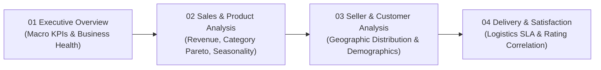

# Olist E-Commerce Power BI Dashboard User & Presentation Guide

## 1. Executive Dashboard Architecture

The **Olist E-Commerce Business Intelligence Dashboard** is an enterprise-grade reporting suite engineered in Power BI Desktop. It delivers an end-to-end analytical view of commercial performance, logistics fulfillment, seller/customer demographics, and consumer sentiment across Brazil.

The dashboard consists of **4 specialized analytical pages** designed with a modern dark navy theme (`#071426` canvas, `#0B203E` cards, `#0084FF` electric blue accents, and white high-contrast typography):



---

## 2. Interactive Navigation & Global Filter Pane

### Sidebar Filters (Left Pane)
Each page features a standardized, non-intrusive left sidebar containing interactive slicers that dynamically filter all visuals on the canvas:
1. **Order Date Range**: Between-date slider and input boxes allowing custom multi-year or quarterly windowing.
2. **Customer State (`customer_state`)**: Dropdown filter supporting multi-select across all 27 Brazilian federal units (e.g., SP, RJ, MG, RS, BA).
3. **Product Category (`product_category_name_english`)**: Dropdown to slice data by specific merchandise lines.
4. **Payment Method (`payment_type`)**: Filter across `credit_card`, `boleto`, `voucher`, `debit_card`.
5. **Order Status (`order_status`)**: Toggle between `delivered`, `shipped`, `canceled`, `invoiced`, `processing`, etc.

### Top Navigation Bar
- Top-right numbered circle buttons (`1`, `2`, `3`, `4`) provide one-click page-to-page navigation across the workbook.
- A "Last Refresh" indicator timestamps the underlying PostgreSQL ingestion cycle.

---

## 3. Page-by-Page Visual & Analytical Breakdown

### Page 01: Executive Overview
- **Purpose**: Provide C-suite leaders and business owners with a 5-second snapshot of overall business health, revenue trajectories, and macro milestones.
- **Top KPI Cards**:
  - `Total Revenue`: **R$ 15.84M**
  - `Total Orders`: **99,441**
  - `Unique Customers`: **96,096**
  - `Total Products`: **32,951**
  - `Total Sellers`: **3,095**
  - `Average Order Value (AOV)`: **R$ 160.58**
- **Core Visuals**:
  1. **Monthly Sales Trend (Line Chart)**: Displays revenue progression over time, highlighting seasonal peaks in May (Mother's Day) and November (Black Friday).
  2. **Order Status Distribution (Donut Chart)**: Highlights healthy 97.02% delivery fulfillment vs. low 0.63% cancelation rate.
  3. **Revenue by Payment Method (Donut Chart)**: Demonstrates dominance of credit cards (73.9%) and Boleto bancário (19.0%).
  4. **Top 5 Product Categories (Horizontal Bar Chart)**: Focuses on the top revenue drivers (Health & Beauty, Watches & Gifts, Bed Bath Table, Sports & Leisure, Computers & Accessories).
  5. **Monthly Order Volume (Column Chart)**: Displays monthly transaction counts without micro-fluctuation clutter.
  6. **Business Performance Summary (Table)**: Metric-by-metric scoreboard comparing Revenue, Orders, Customers, and AOV.

### Page 02: Sales & Product Analysis
- **Purpose**: Deep dive into revenue breakdown, product pricing, freight contributions, and merchandise category margins.
- **Top KPI Cards**:
  - `Product Sales`: **R$ 13.59M** (85.79% of gross)
  - `Total Freight`: **R$ 2.25M** (14.21% of gross)
  - `Total Revenue`: **R$ 15.84M**
  - `Total Products`: **32,951**
  - `Total Orders`: **99,441**
  - `Average Item Price`: **R$ 120.65**
- **Core Visuals**:
  1. **Monthly Revenue & Freight Composition (Stacked Column / Line Chart)**: Tracks the ratio of freight cost to merchandise value over time.
  2. **Top 10 Product Categories by Revenue (Bar Chart)**: Clear ranking of the primary commercial generators.
  3. **Revenue Distribution by Category (Treemap)**: Visual hierarchy of merchandise volume across all active categories.
  4. **Product Category Performance Matrix (Table)**: Detailed tabular drilldown showing Total Orders, Product Revenue, Freight Value, and Average Item Price per category.

### Page 03: Seller & Customer Analysis
- **Purpose**: Map out demographic concentration, seller distribution, and regional commercial asymmetries across Brazil.
- **Top KPI Cards**:
  - `Total Customers`: **96,096**
  - `Total Sellers`: **3,095**
  - `Customer States`: **27**
  - `Seller States`: **23**
  - `Repeat Customer Rate`: **3.12%**
  - `Avg Revenue per Seller`: **R$ 5,119.08**
- **Core Visuals**:
  1. **Top 10 Customer States by Revenue (Horizontal Bar Chart)**: Shows the overwhelming commercial dominance of the Southeast corridor (SP, RJ, MG).
  2. **Seller State Distribution (Bar / Column Chart)**: Illustrates that > 70% of merchants reside in São Paulo state.
  3. **Customer vs. Seller Regional Mapping (Comparative Visual)**: Shows the logistical flow from southeastern production hubs to national consumption points.
  4. **Top 10 Sellers by Revenue (Bar Chart / Table)**: Identifies top-performing SME partners on the platform.
  5. **State-Level Performance Summary (Table)**: Displays Customers, Sellers, Orders, and Gross Revenue by state.

### Page 04: Delivery & Customer Satisfaction
- **Purpose**: Diagnose logistics delivery speed, SLA compliance, and their direct impact on customer ratings and feedback.
- **Top KPI Cards**:
  - `Total Orders`: **99,441**
  - `Delivered Orders`: **96,478**
  - `Average Delivery Days`: **12.56 Days**
  - `On-Time Delivery Rate`: **91.89%**
  - `Average Review Score`: **4.09 / 5.00**
  - `5-Star Review %`: **57.8%**
- **Core Visuals**:
  1. **Review Score Breakdown (Column Chart)**: Distribution of 1 to 5 star ratings across all completed orders.
  2. **Delivery Days vs. Customer Review Score (Scatter / Line Chart)**: Graphically proves the collapse in customer sentiment when delivery delays exceed promised SLAs.
  3. **Average Delivery Time by State (Bar Chart)**: Shows regional delivery friction (8 days in SP vs. 20+ days in North/Northeast states).
  4. **On-Time vs. Delayed Orders (Donut Chart)**: Visual SLA compliance indicator (91.89% on-time).
  5. **Logistics Performance by State (Table)**: Comparative matrix of Orders Delivered, Avg Delivery Days, Avg Estimated Days, and Avg Review Score.

---

## 4. Key DAX Measure Reference Library

The dashboard is powered by high-performance DAX measures defined in `dashboard/DAX_Measures_Reference.dax`:

```dax
// 1. Total Revenue (Product Value + Freight)
Total Revenue = SUM(order_items[price]) + SUM(order_items[freight_value])

// 2. Product Sales
Product Sales = SUM(order_items[price])

// 3. Total Freight
Total Freight = SUM(order_items[freight_value])

// 4. Total Orders
Total Orders = DISTINCTCOUNT(orders[order_id])

// 5. Delivered Orders
Delivered Orders = CALCULATE(DISTINCTCOUNT(orders[order_id]), orders[order_status] = "delivered")

// 6. Unique Customers
Unique Customers = DISTINCTCOUNT(customers[customer_unique_id])

// 7. Average Order Value (AOV)
Average Order Value = DIVIDE([Total Revenue], [Total Orders], 0)

// 8. On-Time Delivery Rate
On-Time Delivery Rate = 
DIVIDE(
    CALCULATE(
        COUNTROWS(orders),
        orders[order_status] = "delivered",
        orders[order_delivered_customer_date] <= orders[order_estimated_delivery_date]
    ),
    CALCULATE(
        COUNTROWS(orders),
        orders[order_status] = "delivered",
        NOT(ISBLANK(orders[order_delivered_customer_date]))
    ),
    0
)

// 9. Average Review Score
Average Review Score = AVERAGE(order_reviews[review_score])

// 10. Repeat Customer Rate
Repeat Customer Rate = 
VAR MultiOrderCustomers = 
    CALCULATE(
        DISTINCTCOUNT(customers[customer_unique_id]),
        FILTER(
            VALUES(customers[customer_unique_id]),
            CALCULATE(DISTINCTCOUNT(orders[order_id])) > 1
        )
    )
RETURN
    DIVIDE(MultiOrderCustomers, [Unique Customers], 0)
```

---

## 5. Client Presentation & Walkthrough Best Practices

When presenting this dashboard to executive stakeholders or prospective clients:
1. **Start with Page 01 for the Macro Story (2 Minutes)**:
   - Anchor the conversation on the top 6 KPI cards. Point out the healthy R$ 15.84M top line, 97% delivery rate, and 96K customer scale.
2. **Move to Page 02 to Explain Revenue Drivers (3 Minutes)**:
   - Highlight the category Pareto distribution: top 5 categories represent 40% of sales.
   - Walk through the freight ratio (14.2%) to illustrate shipping economics.
3. **Use Page 03 to Highlight Geographic Opportunity (3 Minutes)**:
   - Show how São Paulo dominates both supply and demand, and discuss the untapped expansion potential in the North and Northeast.
4. **Close with Page 04 to Connect Operations to Customer Loyalty (3 Minutes)**:
   - Showcase the 91.89% on-time delivery rate.
   - Emphasize the direct statistical link: delays reduce customer review score from 4.38 to 1.35, proving logistics efficiency directly protects brand reputation.
